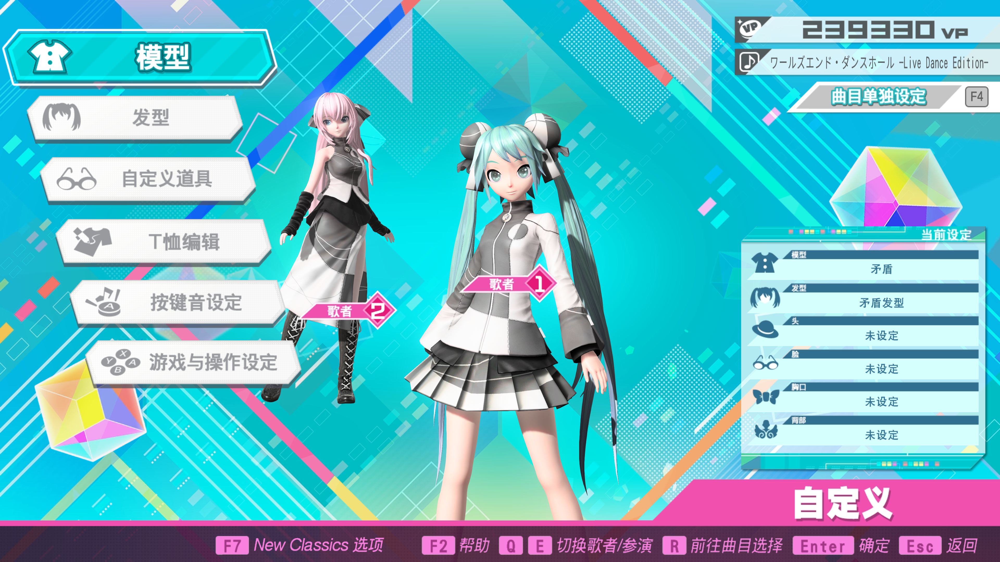
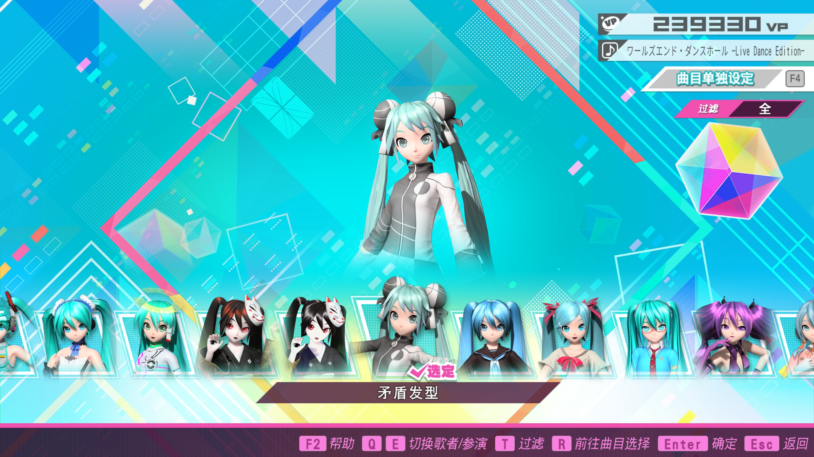
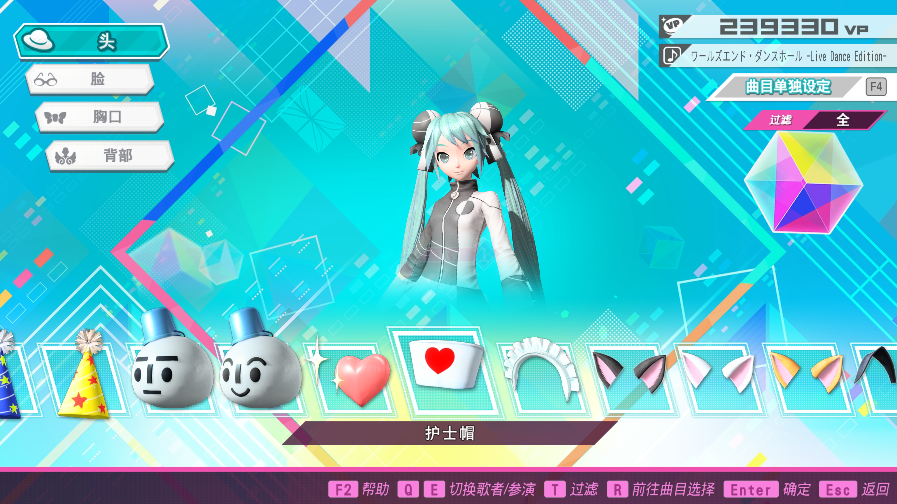

# 原生自定义页面与 UI 层级

日期：2026-11-02。来源：用户在本任务中提供的三张游戏原始截图与逐图说明。用于 Claude 实现搜索界面及接收方验证，不要求 Claude 本机运行游戏。

## 页面结构

```text
原生自定义父页（Parent，场景键1；图一）
├─ 模型             → 模型子页（Module，场景键2）
├─ 发型             → 发型子页（Hair，场景键3；图二）
├─ 自定义道具       → 道具子页（Accessory，场景键4；图三）
│                     ├─ 头   ZUJO
│                     ├─ 脸   FACE
│                     ├─ 胸口 NECK
│                     └─ 背部 BACK
├─ T恤编辑
├─ 按键音设定
└─ 游戏与操作设定
```

模型、发型、自定义道具是同一个父页下的三个独立入口；发型不属于自定义道具，道具也不属于发型。模型子页没有包含在这次三张图中。场景键来自既有原生研究，不是截图独立证明的内存枚举。

本插件搜索面板顶部独立显示：**歌曲｜模型｜发型｜自定义道具**。这是插件领域切换，不要求在 ImGui 里复制原生父页；点击插件 Tab 不触发原生跳页。

发型 Tab 只检索 KAMI；自定义道具 Tab 才提供“头、脸、胸口、背部”筛选。内部已有 `Neck`／“胸颈”字段可保留，但新增玩家界面统一用截图中的“胸口”。三个定制领域分别保留查询、人物／来源筛选、选择及滚动状态。

## 图一：自定义父页



左侧显示模型、发型、自定义道具等同级入口。右侧“当前设定”分别列模型、发型，以及头、脸、胸口、背部四个道具槽；这也说明发型不是一个饰品部位。

截图有两名歌者，底部有 Q／E 切换歌者／参演，右上为“曲目单独设定”。实现需要保留当前歌者槽位和设定范围语义，不能从画面人物或查询人物直接推断写入槽位。此截图显示单曲设置场景，不代表所有共通设置都已验证。

## 图二：发型子页



底部横向发型候选列表和名称“矛盾发型”，中央为角色展示，右侧显示过滤状态。候选缩略图包含人物上半身，不能仅凭图片看起来像模型卡片，就把发型实体归入模型。

本插件仍使用已有搜索卡片形式，不必复制原生横向轮播；结果应有发型名称、人物、稳定ID和来源。截图中的“选定”标记只作为可见状态参考，真实已装备标记仍需由本机核对其独立读回字段。

## 图三：自定义道具子页



左侧为头、脸、胸口、背部；当前在头部，底部列表显示护士帽等道具。四个部位属于同一个道具子页，切部位与切换发型／模型页面是不同操作层级。

本插件道具 Tab 内提供四部位筛选；原生定位目标需要同时包含稳定ID及正确部位。搜索筛选只改变插件结果，不能因此自动切换原生部位或页面。

## 跳转与动作要求

- 同目标原生页内可请求原位定位；跨原生页必须鼠标左键双击同一结果主体。
- 普通单击、Enter、悬浮、更换／预览按钮、切搜索Tab都不获得跨页权限；保留现有歌曲难度按钮独立行为。
- 模型、发型、道具切页走页面路由；道具的头／脸／胸口／背部切换走道具页内部分类协议，不能混为一个pageKey。
- 悬浮只展示动作按钮，不自动试穿。原生高亮、搜索选中、临时预览和实际装备应分开表达。
- 三张图证明UI层级与可见内容，不证明任意发型／道具ID已能程序定位、预览或更换；对应协议和本机待验项见交接报告。

## Claude 与本机的交付分工

Claude 负责完成功能代码、自审、能在其环境执行的测试并提交 PR；它的运行环境不是 Windows、没有游戏，不要求其完成全量 Windows 构建或截图验收。本机接收 PR 后拉取代码，负责 Windows 构建、预览和实际游戏验证。

完整实现入口、数据来源及导航协议见 [发型／道具 Claude 交接报告](../docs/HAIR_ACCESSORY_CLAUDE_HANDOFF.md)。
